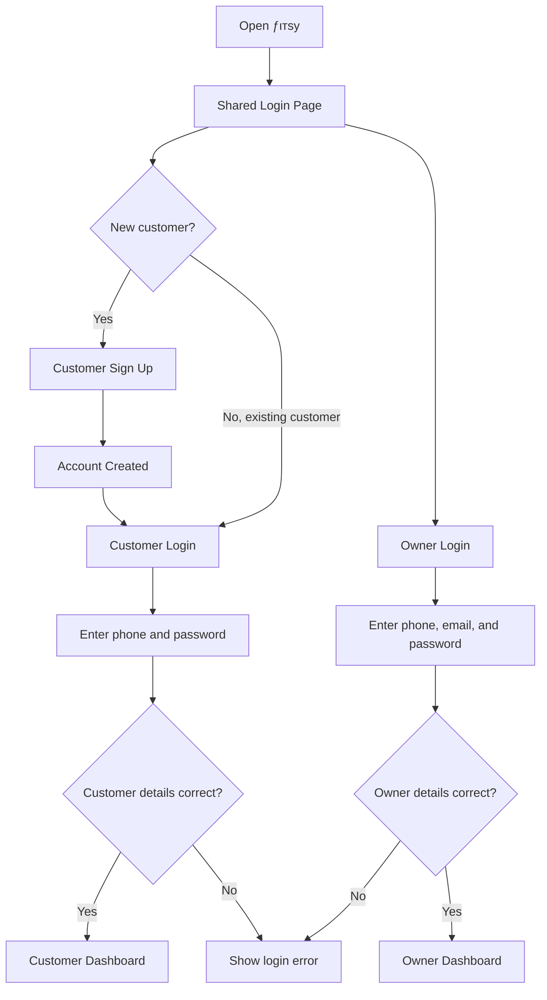
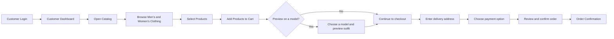
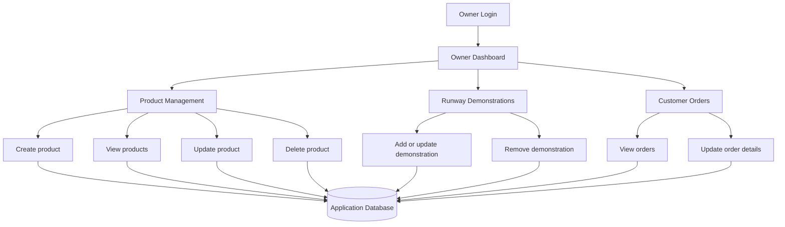
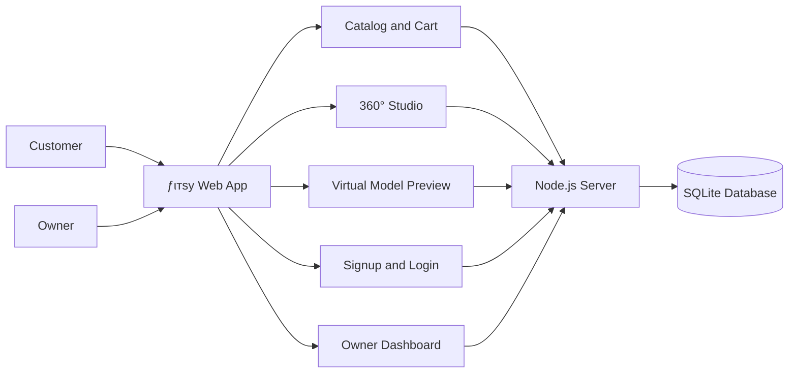

# 👕 ƒιтѕу 👖

### 👚 Fashion · 360° Views · Virtual Runway 👗

**Explore your style. Discover every detail.**

A digital fashion app for browsing Men’s and Women’s collections, exploring garments in 360°, and previewing outfits on virtual models.

---

## 📖 Contents

- [About ƒιтѕу](#-about-ƒιтѕу)
- [Features](#-features)
- [Account Access](#-account-access)
- [Customer Shopping Journey](#-customer-shopping-journey)
- [Owner Dashboard](#-owner-dashboard)
- [System Architecture](#-system-architecture)
- [Technology Stack](#️-technology-stack)
- [Team](#-ƒιтѕу-team)

---

## ✨ About ƒιтѕу

**ƒιтѕу** is a digital fashion shopping app for exploring **Men’s and Women’s clothing**. Customers can browse the catalog, inspect garments from different angles using 360° views, and optionally preview an outfit on a virtual model before placing an order.

The app also includes an owner section for managing products, runway demonstrations, and customer orders.

---

## 🌟 Features

| Symbol | Feature | Description |
|:---:|---|---|
| 👕 | **Fashion Catalog** | Browse Men’s and Women’s collections. |
| 👖 | **Product Cart** | Add selected products to the cart. |
| 👗 | **360° Studio** | Explore garments from different angles. |
| 👚 | **Virtual Model Preview** | Optionally preview clothing on a model. |
| 📍 | **Delivery Details** | Enter an address for the order. |
| 💳 | **Payment** | Continue through the available payment option. |
| 📦 | **Order Confirmation** | Review the order after checkout. |
| 🎨 | **Owner Section** | Manage products, runway items, and orders. |

---

## 🔐 Account Access

New customers create an account first. After signup, they can log in through the same login page used by existing customers.

The shared login page provides separate access paths:

- **Customer:** Phone number and password.
- **Owner:** Phone number, email address, and password.
- Successful customer login opens the **Customer Dashboard**.
- Successful owner login opens the **Owner Dashboard**.

---

## 🛍️ Customer Shopping Journey

From the customer dashboard, customers can browse the catalog, add products to their cart, and continue to checkout. Trying an outfit on a virtual model is optional.

---

## 🎨 Owner Dashboard

The owner can manage products, runway demonstrations, and customer orders. Product management may include creating, viewing, updating, and deleting product records.

---

## 🏗️ System Architecture

---

## 🧰 Technology Stack

| Area | Technologies |
|---|---|
| **Frontend** | HTML5, CSS3, JavaScript, TypeScript |
| **3D Visualization** | Three.js, WebGL |
| **Build Tool** | Vite |
| **Backend** | Node.js |
| **Database** | SQLite |
| **Maps and Location** | Leaflet.js, OpenStreetMap Nominatim |
| **Version Control** | Git, GitHub |

---

## 👥 ƒιтѕу Team

### ✨ The Team Behind ƒιтѕу ✨

| 🪪 Student ID | 👤 Team Member |
|:---:|:---|
| **2620030089** | **Manideep** |
| **2620030105** | **Gowtham Sai** |
| **2620030104** | **Vishwak** |

👕 &nbsp; 👖 &nbsp; 👗 &nbsp; 👚

---

# 👕 ƒιтѕу 👖

### **Fashion for Men. Fashion for Women. Style for Everyone.**

*Find your style with ƒιTѕу.* 👗

